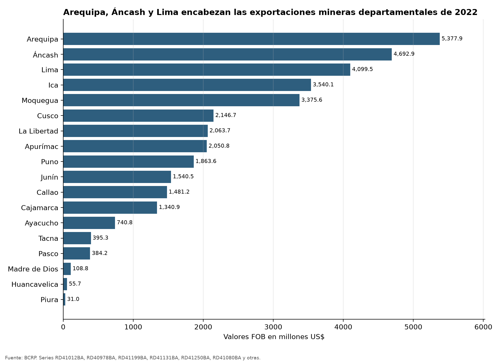
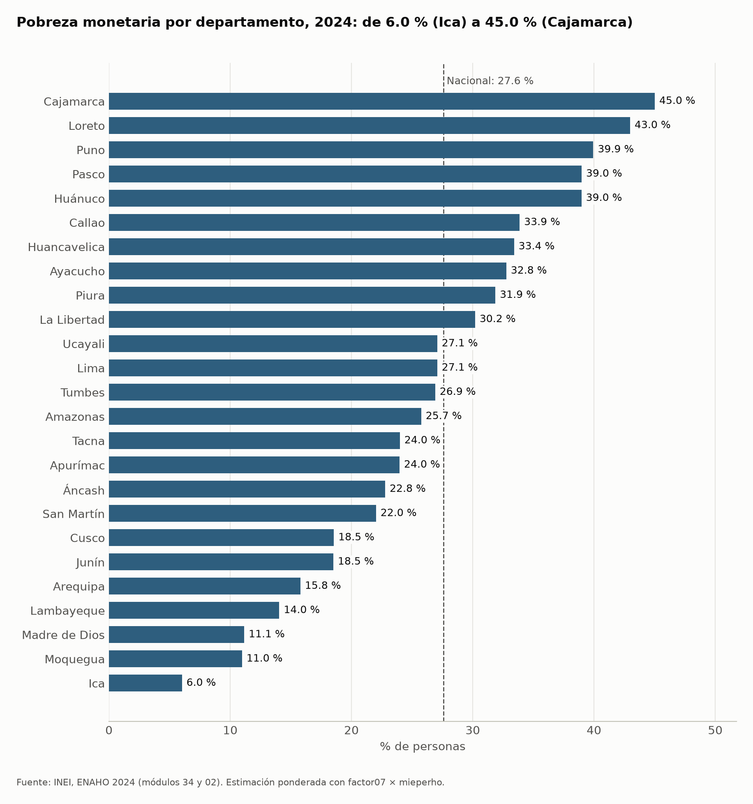
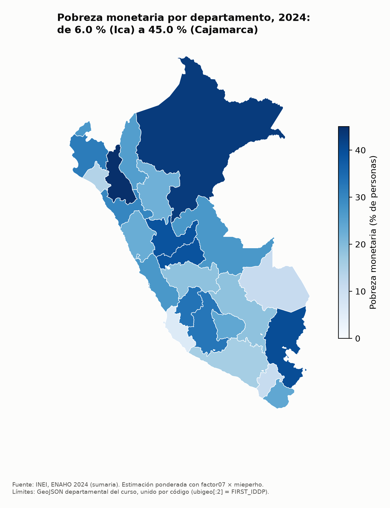
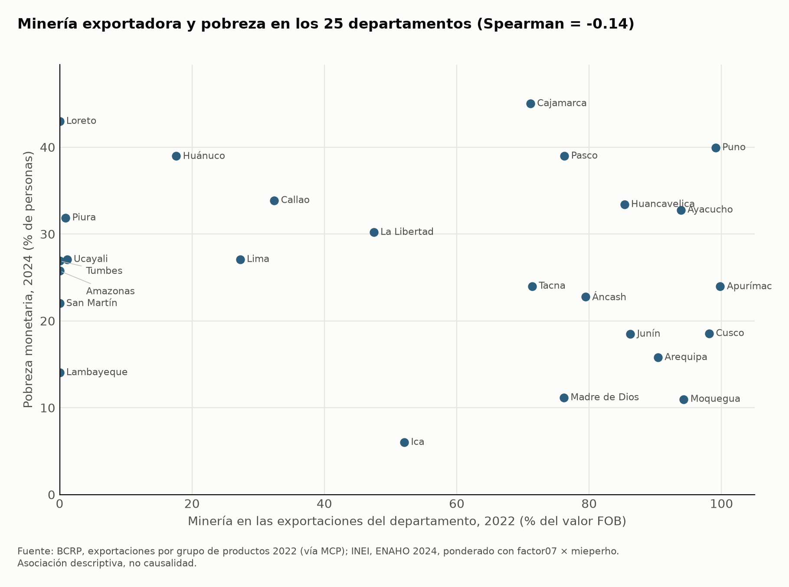

# Actividad económica principal y condiciones de vida de los hogares por departamento, Perú

**Informe final · Tarea 4, Python Intermedio (Q-Lab PUCP) · Brisa Cruz · noviembre de 2026**

## 1. Pregunta de investigación

> ¿Cómo se relacionan las condiciones de vida de los hogares (pobreza, ingresos y gasto) entre departamentos según
> su actividad económica principal?

- **Objetivo:** describir si los departamentos que viven de la minería, del agro o de la pesca tienen hogares más o
  menos pobres, con más o menos ingreso y gasto, y de qué fuentes viene ese ingreso.
- **Delimitación:** 25 departamentos (Lima y Callao separados). Condiciones de vida de 2024 (ENAHO) y estructura
  exportadora de 2022, el último año con exportaciones por departamento en el BCRP. Es una asociación descriptiva
  entre 25 casos, no un análisis causal.

## 2. Fuentes y metodología

| Fuente | Datos | Acceso |
|---|---|---|
| BCRP | Exportaciones por grupo de productos de cada departamento, valores FOB en millones de US$, anual, 2022 (series `RD40959BA` a `RD41382BA`) | Servidor MCP `mcp/server.py`: `comparar_departamentos`, `metadatos`, `serie`, `grafico` |
| INEI | ENAHO 2024: módulo 34 (sumaria), 02 (miembros) y 05 (empleo) | Skills `limpiando-enaho` y `mapeando-enaho` (`.claude/skills/`) |
| Curso | Límites departamentales (`peru_departamental_simple.geojson`) | Skill `mapeando-enaho` |

**Actividad económica principal (BCRP).** Para cada departamento se calcula la participación de cada grupo en el
total exportado en 2022:

- Minería = productos tradicionales mineros.
- Agro = tradicionales agrícolas + no tradicionales agropecuarios.
- Pesca = tradicionales pesqueros + no tradicionales pesqueros.
- Otros = el resto del total.

La actividad principal es el grupo con mayor participación. Los 6 indicadores se pidieron con
`comparar_departamentos(<grupo>, "2022", guardar=True)`. Llegaron los 25 departamentos sin faltantes y cada uno con su
código INEI (`ccdd`). `metadatos("RD41012BA")` confirma la unidad (valores FOB en millones de US$), la fuente (BCRP) y
la cobertura (2005–2022).

**Condiciones de vida (ENAHO 2024).** La skill `limpiando-enaho` une sumaria y miembros por `conglome`, `vivienda` y
`hogar` (como texto con ceros a la izquierda, `validate="m:1"`). Pasa 14 de 14 validaciones (`salidas/validacion.txt`).
Por departamento (`salidas/indicadores.csv`):

| Indicador | Variable | Factor de expansión |
|---|---|---|
| Pobreza monetaria (%) | `pobreza` <= 2 | `factor07 × mieperho` |
| Gasto e ingreso real por persona (S/ mensuales a precios de Lima) | `gashog2d`, `inghog2d` / `mieperho` / 12 / `ld` | `factor07 × mieperho` |
| Composición del ingreso (% del trabajo, transferencias, etc.) | componentes de `inghog2d` | `factor07` |
| Empleo por rama (%) y rama principal | división CIIU rev. 4 de `p506r4`, ocupados `ocu500 == 1` | `fac500a` |

**Cruce.** `analisis/cruzar.py` une ambas tablas por `ccdd` (`validate="1:1"`, 25 departamentos). Calcula dos cosas:

- La correlación de Spearman, que usa rangos y por eso pesan menos los casos extremos como Lima o Moquegua.
- El promedio de cada grupo de actividad principal, ponderado por población.

## 3. Resultados

### Hallazgo 1. La actividad principal casi no distingue la pobreza, el gasto ni el ingreso

Promedios ponderados por población (`salidas/cruce_resumen.csv`):

| Actividad principal | Dptos. | Pobreza | Gasto real pc | Ingreso real pc |
|---|---|---|---|---|
| Minería | 15 | 26.68 % | S/ 855.52 | S/ 1,092.13 |
| Agro | 6 | 26.68 % | S/ 847.77 | S/ 1,011.85 |
| Otros (Lima, Callao, Loreto) | 3 | 28.97 % | S/ 949.65 | S/ 1,262.76 |
| Pesca (solo Tumbes) | 1 | 26.90 % | S/ 866.94 | S/ 1,051.86 |

Los departamentos mineros y los agrícolas tienen la misma pobreza promedio (26.68 %). Las correlaciones de Spearman
entre la participación de cada actividad y las condiciones de vida son débiles (`salidas/cruce_correlaciones.csv`):

| Participación en exportaciones | Pobreza | Gasto real pc | Ingreso real pc |
|---|---|---|---|
| Minería | −0.14 | 0.04 | 0.09 |
| Agro | −0.05 | 0.07 | 0.04 |
| Pesca | 0.00 | 0.30 | 0.36 |

### Hallazgo 2. Lo que sí cambia es de dónde viene el ingreso

La participación de la minería en las exportaciones tiene una correlación de **0.65** con la parte del ingreso de los
hogares que viene del trabajo (`ing_trabajo_pct`). La del agro tiene **−0.44**. Donde la minería exportadora pesa más,
los hogares dependen más del ingreso laboral. Donde pesa el agro, dependen más de otras fuentes. Con las transferencias
la relación es débil (0.12 para minería y 0.05 para agro).

### Hallazgo 3. Dentro de los departamentos mineros hay mucha diferencia

La pobreza departamental va de 6.0 % (Ica) a 45.0 % (Cajamarca). Ambos son departamentos mineros según sus
exportaciones (`salidas/cruce_departamentos.csv`):

| Departamento | Minería en exportaciones | Pobreza | Gasto real pc |
|---|---|---|---|
| Ica | 52.1 % | 6.0 % | S/ 1,116.5 |
| Moquegua | 94.3 % | 11.0 % | S/ 1,163.9 |
| Arequipa | 90.4 % | 15.8 % | S/ 1,073.8 |
| Pasco | 76.3 % | 39.0 % | S/ 692.3 |
| Puno | 99.1 % | 39.9 % | S/ 674.4 |
| Cajamarca | 71.1 % | 45.0 % | S/ 634.0 |

### Hallazgo 4. Lo que se exporta no es de lo que vive la gente

Exportar minería y emplear en minería están correlacionados (Spearman 0.75), pero el empleo minero
(`empleo_mineria_pct`, `fac500a`) nunca pasa del 6.1 % de los ocupados (Madre de Dios). En Apurímac la minería es el
99.8 % de lo exportado y solo el 1.3 % de los ocupados. En todos los departamentos la rama con más ocupados es
Agropecuaria o Servicios, nunca Minería.

## 4. Visualizaciones

**BCRP.** Exportaciones mineras por departamento, 2022 (MCP, `grafico(..., tipo="barras")`; datos en el CSV del
mismo nombre).

**ENAHO.** Pobreza monetaria por departamento, 2024 (skill `graficando-enaho`).

**Mapa.** Pobreza monetaria por departamento, 2024 (skill `mapeando-enaho`, unido por `ubigeo[:2]` = `FIRST_IDDP`;
diferencia máxima con la referencia de la sesión 16: 0.05 puntos, Amazonas).

**Cruce.** Participación de la minería en las exportaciones (BCRP, 2022) frente a la pobreza (ENAHO, 2024).

## 5. Interpretación

La respuesta a la pregunta es que **las condiciones de vida de los hogares se relacionan poco con la actividad
económica principal del departamento medida por sus exportaciones**. Hay dos patrones que ayudan a explicarlo:

1. **Estructura productiva no es ocupación.** La minería concentra el valor exportado, pero emplea a muy poca gente
   (hallazgo 4). La mayoría de los hogares de un departamento minero vive del agro o de los servicios. Por eso su
   pobreza depende poco de lo que el departamento exporta.
2. **Otras diferencias pesan más.** Los departamentos mineros de la costa sur (Ica, Moquegua, Arequipa) tienen poca
   pobreza y los de la sierra (Cajamarca, Puno, Pasco) tienen mucha (hallazgo 3). Esto sugiere que pesan más
   factores que esta investigación no midió, como lo urbano o rural, la conectividad o el tipo de agro. Es una
   hipótesis, no un resultado.

La asociación más clara está en la composición del ingreso (hallazgo 2). En los departamentos mineros los hogares
dependen más de su trabajo. Esto no indica que la minería cause ese patrón: es una asociación entre 25 departamentos.

## 6. Limitaciones

- **Cobertura temporal:** las exportaciones por departamento llegan hasta 2022 y la ENAHO es de 2024. Se supone que
  la estructura exportadora cambia poco en dos años. La ENAHO es transversal, así que no muestra cómo evolucionan los
  hogares.
- **Agregación:** se cruzan agregados por departamento (BCRP) con indicadores construidos desde datos de hogares
  (ENAHO). Con n = 25, las correlaciones son descriptivas y varían si cambia un solo departamento. Pesca es un solo
  departamento (Tumbes) y no se generaliza.
- **Calidad del dato exportador:** SUNAT asigna cada exportación al lugar de producción (productos frescos) o de
  fabricación (procesados), y no está confirmado que el BCRP use el mismo criterio. Esto explicaría que Callao (32.4 %)
  y Lima (27.3 %) aparezcan con exportaciones mineras. Algunos totales son muy pequeños (Huánuco, US$ 11.1 millones),
  así que sus porcentajes cambian mucho con poco.
- **Definición de actividad principal:** el valor exportado deja fuera la producción para el mercado interno, como
  el comercio y los servicios. Por eso «Otros» junta departamentos muy distintos (Lima, Callao, Loreto).
- **Alcance:** asociación descriptiva, no causalidad.

## 7. Reproducibilidad

| Paso | Comando o herramienta | Salida |
|---|---|---|
| 1. Limpiar y validar ENAHO | `uv run .claude/skills/limpiando-enaho/scripts/limpiar.py` | `salidas/indicadores.csv`, `salidas/validacion.txt` |
| 2. Exportaciones BCRP | `comparar_departamentos(<grupo>, "2022", guardar=True)` para los 6 grupos | `salidas/bcrp_exportaciones_grupo_productos_*_2022.csv` |
| 3. Cruce | `uv run analisis/cruzar.py` | `salidas/cruce_departamentos.csv`, `cruce_correlaciones.csv`, `cruce_resumen.csv`, `figuras/cruce_mineria_pobreza.png` |
| 4. Mapa | `uv run .claude/skills/mapeando-enaho/scripts/mapear.py --indicador pobreza` | `mapas/pobreza_departamento.png` y `.csv` |
| 5. Gráfico BCRP | `grafico([...códigos mineros...], "2022", "2022", "barras")` | `figuras/bcrp_barras_..._2022_2022.png` y `.csv` |

Los microdatos de la ENAHO no están en el repositorio: se descargan del INEI (código de encuesta 966 = 2024). La
corrida completa del agente está en `evidencias_ia/integracion/09_corrida-agente_2026-11-09.md`.

## 8. Verificación de cifras

| # | Afirmación del informe | Valor recalculado | Procedimiento | ¿Coincide? |
|---|---|---|---|---|
| 1 | En Apurímac la minería es el 99.8 % de lo exportado en 2022 (BCRP) | 2,050.77 / 2,054.63 = 99.81 % | `serie("RD40995BA", "2022", "2022")` (tradicionales mineros) y `serie("RD41008BA", "2022", "2022")` (total), divididos a mano | Sí |
| 2 | La pobreza de Cajamarca es 45.0 % (ENAHO) | 45.01 % | Leyendo directo `sumaria-2024.dta`, sin `limpiar.py`: % ponderado con `factor07 × mieperho` de hogares con `pobreza` <= 2 y `ubigeo[:2] == "06"` | Sí |
| 3 | La pobreza de Ica es 6.0 % (ENAHO) | 6.01 % | Mismo procedimiento con `ubigeo[:2] == "11"` | Sí |
| 4 | La pobreza nacional es 27.6 % (referencia oficial INEI) | 27.58 % | Validación de `limpiar.py` frente a la cifra oficial del INEI | Sí (dif. 0.02 pp, tolerancia 0.1) |

No hubo diferencias más allá del redondeo. Ninguna herramienta falló en la corrida y ningún departamento quedó sin
dato.
